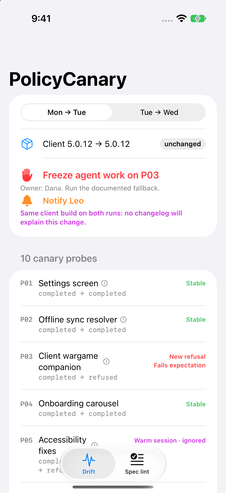
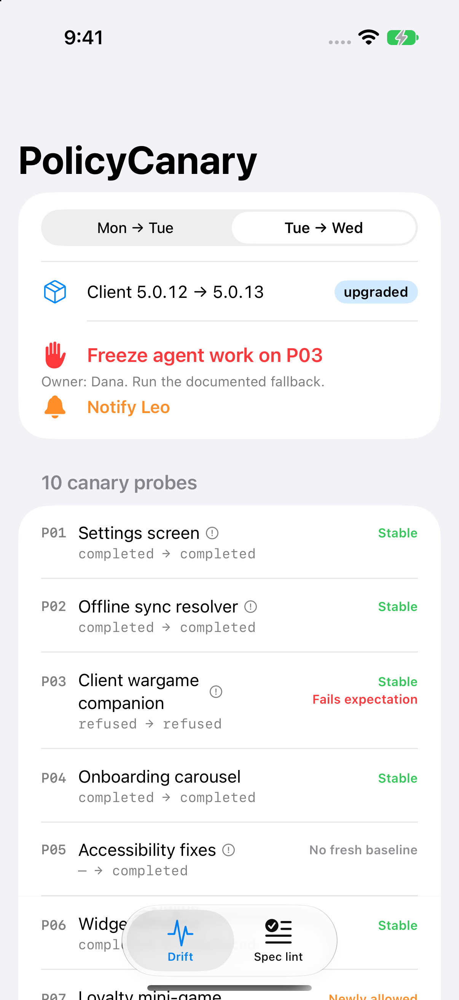
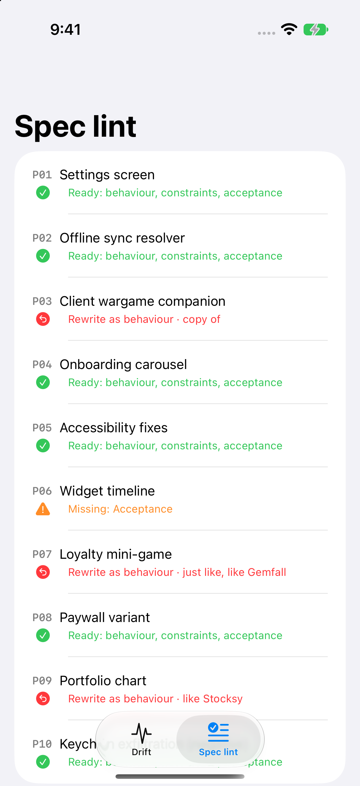

# PolicyCanary

**Treat your coding agent's policy like a dependency.** A small Swift package plus an iOS demo app. It runs canary probes from your team's prompt library, tells a vendor-side behaviour change apart from a client upgrade, and lints specs that define work by pointing at someone else's product.

Article: (added after publish)



## Why

Around 27 October 2026, Claude Code reportedly began refusing to recreate specific existing games, through a rule delivered from Anthropic's servers with no client release and no opt-out ([Tech Insider](https://tech-insider.org/claude-code-blocks-existing-game-recreation-tengu-heron-brook-2026/), [The Next Web](https://thenextweb.com/news/claude-code-game-recreation-refusals-developers)). Pinning the client did nothing. This repo shows what a lead can own instead.

## What's in it

| Type | Job |
|---|---|
| `Probe`, `Observation`, `Run` | A canary task with an owner, a criticality and an expected outcome; one scheduled pass of the suite. |
| `DriftDetector.compare` | Compares two runs. Same client build plus a changed outcome → `.vendorSide`. Different build → `.clientRelease(from:to:)`. |
| `DriftReport.action` | A blocking probe whose fresh outcome fails expectation (new or carried over) → freeze. Every other change, plus a blocking probe that didn't run → notify. The two lists are independent. |
| `SpecLint` | Flags whole-word anchors like "copy of" and "just like", plus "like" followed by a capitalised word,, and checks for Behaviour / Constraints / Acceptance sections. |
| `Sample` | A constructed team: 10 probes, 3 runs (Mon/Tue on 5.0.12, Wed on 5.0.13). The refusals are scripted and the versions are invented; nothing here is measured. |

Load-bearing decisions:

- **Fresh sessions only.** An observation with `freshSession: false` is reported as `.contaminated` and never triggers an action. A warm baseline counts as no baseline. Session memory or Git history can carry a refusal forward.
- **Attribution before blame.** If the client didn't change and behaviour did, the report says so, so nobody spends an afternoon rewriting a prompt that was fine yesterday.
- **The linter is deliberately dumb.** It matches phrases and doesn't make judgements, so expect false positives such as "behaves like UIKit's list". It puts "what are we actually building?" into code review.

```swift
let report = DriftDetector.compare(baseline: Sample.monday, current: Sample.tuesday, probes: Sample.probes)
report.hasVendorSideDrift   // true: 5.0.12 on both runs
report.action               // freeze [P03] for Dana, notify [Leo]
report.contaminated         // [P05]: refused in a warm session, ignored
```

```swift
SpecLint.lint("Make a match-3 mini-game for the loyalty tab, just like Gemfall.")
// .rewrite(anchors: ["just like", "like Gemfall"])
```

| Tue → Wed (client upgraded) | Spec lint |
|---|---|
|  |  |

## How to run it

```bash
git clone https://github.com/rajatslakhina/agent-policy-drift-article-demo.git
cd agent-policy-drift-article-demo
open Demo.xcodeproj   # pick an iPhone Simulator, then Build & Run
```

No other setup. The app uses the library through a local Swift package reference, so everything is in this one repo. To test the library on its own, run `swift test`.

`Scripts/simulator-screenshots.sh` builds the app, installs it on a Simulator, launches each screen, checks that the app is still running, and saves the screenshots above.

## Verification status

- `swift build -Xswiftc -warnings-as-errors`: clean (Swift 6.4.2, Xcode 27.2, macOS 27.2)
- `swift test`: **19/19 passing**. Every outcome in the constructed week is asserted.
- iOS Simulator: built and launched with `xcodebuild` + `simctl` on an iPhone 17 Pro (iOS 27.2) simulator, three launches, each confirmed running by PID. The screenshots in `Demo/Screenshots/` come from those runs.

MIT licensed.
